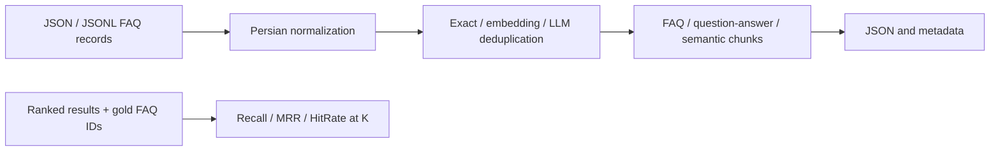

# Persian RAG Preprocessing API

[](https://github.com/robbiinn/persian-rag-preprocessing-api/actions/workflows/tests.yml)

A FastAPI service for preparing Persian FAQ data for retrieval-augmented generation:
normalize text, remove duplicates, create retrieval chunks, and evaluate ranked results.
Developed during an internship and adapted for a public portfolio with synthetic data.

**Stack:** Python · FastAPI · Pydantic · Hazm · Sentence Transformers · Docker



## Features

- Normalize Persian/Arabic characters, whitespace, punctuation and HTML.
- Remove exact duplicates; optionally use embeddings or an LLM to classify duplicates and variants.
- Keep complete FAQ pairs, separate questions from overlapping answer chunks, or split by semantic topic shifts.
- Accept JSON bodies and JSON/JSONL uploads, with record limits and a `MAX_UPLOAD_MB` request-body limit enforced across `/v1` routes.
- Evaluate single queries, batches and grouped RAG output using gold identifiers.
- Interactive OpenAPI documentation, optional API-key authentication, and container configuration.

## Quick start

Use **Python 3.11**. Hazm 0.10.0 pins NumPy 1.24.3, so newer Python versions are not supported by this dependency set.

```bash
python -m venv .venv
# Linux/macOS: source .venv/bin/activate
# Windows PowerShell: .venv\Scripts\Activate.ps1
python -m pip install -r requirements-dev.txt
python -m uvicorn app.main:app --host 127.0.0.1 --port 8000
```

Open [Swagger UI](http://127.0.0.1:8000/docs). Basic normalization, FAQ chunking and
retrieval evaluation need no API credentials or embedding-model download.

Send the included synthetic library records (use `curl.exe` on Windows):

```bash
curl -X POST http://127.0.0.1:8000/v1/pipeline \
  -H "Content-Type: application/json" \
  --data-binary @examples/pipeline-request.json
```

The four input records contain one exact duplicate: the result contains **three FAQ chunks**.
Each chunk includes normalized question/answer text, `embedding_text` and source metadata.

For file upload, use `/v1/pipeline/file` in Swagger with `examples/faq.json`.
Set `chunking` to `{"method":"question_answer","max_chars":100,"overlap_chars":20}`
to explore answer chunking.

## Configuration

See [.env.example](.env.example). The application reads process environment variables;
it does **not** automatically load `.env`. Docker Compose loads `.env`, or you can run
`python -m uvicorn app.main:app --env-file .env` locally after creating it.

| Variable | Purpose |
|---|---|
| `API_KEY` | Optional key for `/v1` routes; clients send `X-API-Key` |
| `MAX_UPLOAD_MB`, `MAX_RECORDS` | Upload and record limits |
| `EMBEDDING_MODEL` | Local Sentence Transformers model |
| `OPENAI_API_KEY`, `OPENAI_BASE_URL` | Optional OpenAI-compatible provider settings |
| `LLM_MODEL` | Model for LLM duplicate classification |

`embedding_dedup` and `semantic` use a local model by default (downloaded on first use).
Selecting `embedding_provider=openai` sends text to the configured provider;
`llm_dedup` also sends candidate FAQ pairs to that provider. Choose these methods only
for data you are permitted to send. Basic preprocessing stays local.

## API routes

| Route | Purpose |
|---|---|
| `GET /health` | Health check |
| `GET /v1/capabilities` | Supported methods and limits |
| `POST /v1/normalize`, `/v1/chunk`, `/v1/pipeline` | JSON preprocessing |
| `POST /v1/normalize/file`, `/v1/chunk/file`, `/v1/pipeline/file` | File preprocessing |
| `POST /v1/evaluate/retrieval` | One ranked result list |
| `POST /v1/evaluate/retrieval/batch` | Multiple queries |
| `POST /v1/evaluate/retrieval/file` | JSON/JSONL evaluation cases |
| `POST /v1/evaluate/retrieval/rag-output/file` | Initial vs. grouped retrieval |

See [evaluation examples](docs/evaluation.md) for schemas and expected metrics.
These metrics evaluate retrieval relevance by ID; they do not score answer faithfulness.

## Docker

Copy `.env.example` to `.env`, then run:

```bash
docker compose up --build -d
```

The default binding is `127.0.0.1:8000`. The container runs as a non-root user with one
worker to avoid loading multiple copies of the embedding model. Heavy requests are
synchronous; this is a portfolio service, not a demonstrated high-throughput deployment.

## Tests

```bash
python -m unittest discover -s tests -v
```

Tests cover normalization, exact deduplication, upload validation, chunk constraints,
retrieval metrics and grouped evaluation. Semantic tests inject deterministic vectors;
they do not benchmark a live model. CI runs without API keys or model downloads.

## Data and project scope

All included examples describe a fictional library. Company datasets, production
outputs, private infrastructure documentation and private Git history are excluded.
See [data and provenance](DATA_NOTICE.md). No accuracy improvement or production-scale
performance is claimed without a reproducible evaluation.

Related: [Persian Hybrid Retrieval](https://github.com/robbiinn/persian-hybrid-retrieval).
